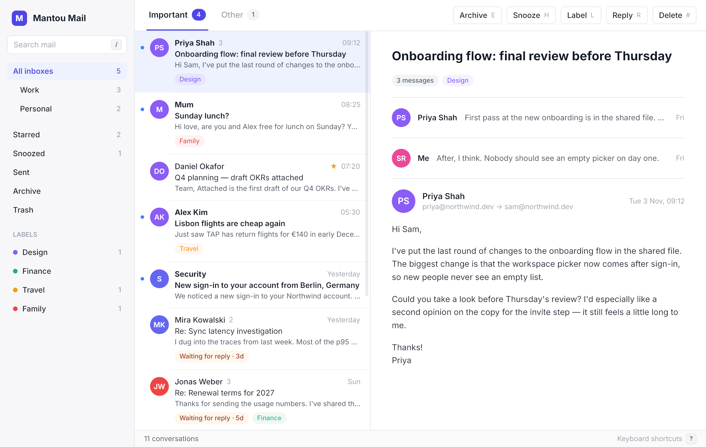

# Mantou Mail

A desktop mail client written in TypeScript and Solid-style JSX, running on [Mantou](https://github.com/dunkbing/mantou): the app runs in a Bun Worker, and Mantou's Rust core lays it out and draws it on the GPU. No webview.



Conversations, Important/Other tabs, labels, snooze, search, quick replies and undo, all from the keyboard (`?` lists the keys) or the mouse.

> **Early.** It runs on built-in sample mail (no accounts yet), and there's no compose until Mantou has text input. What the app needs from Mantou, and how it works around it meanwhile, is in [docs/upstream.md](docs/upstream.md).

## Run it

Needs [Bun](https://bun.sh) 1.4.4 and [Rust](https://rustup.rs) (to build Mantou's native core once).

```bash
bun install
```

```bash
bun run setup
```

```bash
bun run dev
```

## Keys

| Key | | Key | |
|---|---|---|---|
| `j` / `k` | older / newer message | `e` | archive |
| `1` / `2` | Important / Other | `i` | move to Inbox (from Archive, Snoozed, Trash) |
| `/` | search (Enter keeps the results, Esc goes back) | `#` | delete (in Trash: for good) |
| `?` | keyboard shortcuts | `h` | snooze (then `1`–`4`) |
| `Esc` | close a panel, leave search | `l` | labels (then `1`–`4` toggle) |
| `z` | undo | `r` | quick reply (then `1`–`3`) |
| `s` | star | `u` | mark read / unread |

## Test

```bash
bun test
```

The tests run the app on a headless instance of Mantou's real core: layout, presses, keys, the wheel and captured pixels, with no window.
