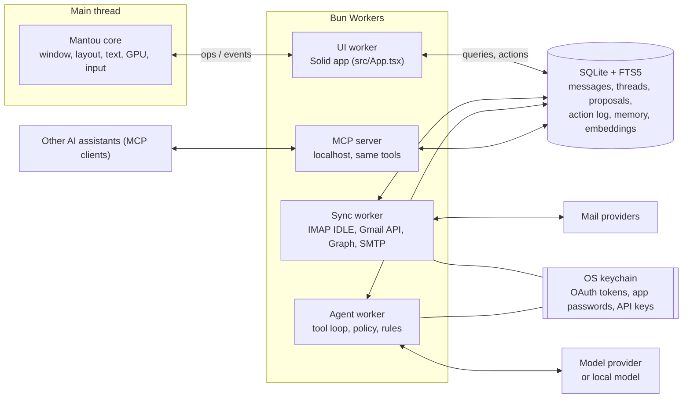

# Mantou Mail: design for an agentic email app

Draft, 3 November 2026.

## Summary

Mantou Mail becomes a local-first desktop mail client with an agent that does the routine work of an inbox and asks before anything leaves it. Each morning the agent has already sorted, summarised and drafted. You review a short queue of proposals ("archive these 14", "reply to Priya", "chase Jonas") and approve each one with a single keystroke.

Three rules shape everything:

- **Your mail stays on your machine.** Mail syncs straight from the provider to a local store. Only the text a task needs goes to the model, and you can see exactly what was sent.
- **The agent proposes; you decide.** Reading, sorting and drafting happen automatically. Sending, deleting, unsubscribing and anything else that leaves the machine needs your approval, unless a standing rule you wrote covers it.
- **Everything is undoable and logged.** Each agent action is an entry you can inspect and reverse, the way `z` undoes triage today.

It is not a hosted service, a team inbox or a CRM. It is one person's mail, made manageable.

## Features

Mantou Mail already has an Important/Other split, Waiting for Reply chips and snooze presets. The agentic version adds these:

| Feature | What it does |
| --- | --- |
| Write with AI | Three suggested replies when you open a message, in the reply panel where today's three canned replies are. Pick one or describe what you want, and a draft streams in; one press makes it shorter, friendlier or more formal |
| Sound Like Me, AI Memory | Learns your style per recipient from your Sent mail, on device. A page shows what it learned and can forget a person |
| Ask AI | Plain-language questions across all accounts, in the agent chat; answers cite the emails they came from |
| Summaries | Written automatically for long threads and kept, so an email is never summarised twice |
| Waiting for Reply | When a thread has waited too long (2–7 days, your choice), the agent drafts the follow-up into the Queue |
| Clean Up Subscriptions | Open rate per sender; the agent proposes a cleanup weekly, and unsubscribing needs approval |
| MCP server | AI assistants can search, read and draft, but never send, delete or move. Spam, Trash and sign-in codes are hidden from them, and their recent activity is logged. It is also the agent's own set of tools |
| Models | Your own key for a cloud model, or a local model, set per task |

Beyond suggestions:

- **Standing rules and a proposal queue.** Rules you write ("archive receipts after I've seen them", "always say no thanks to recruiters") let the agent act without asking, within limits you set. A proposal queue lets you review a day's suggestions together instead of one at a time.
- **Platforms.** macOS, Windows and Linux from one codebase.
- **A privacy statement that holds for every path.** If any feature sends mail text to a model (translation, say), the statement says so, and each task shows what it sent.

## Goals and non-goals

Success is measured in time: a 200-message day handled in under 10 minutes of review, with nothing sent that you would not have sent yourself.

**Goals**

1. Real accounts: Gmail, Outlook and any IMAP/SMTP server, several at once, usable offline.
2. A full mail client without the agent: read, compose, search, label, snooze, undo. The agent is an extra layer, not something the app depends on.
3. An agent that triages, summarises, drafts, follows up and answers questions about your mail, with citations.
4. Standing rules written in plain language, each shown with what it did and a way to turn it off.
5. Bring your own model: a cloud key or a local model, chosen per task.
6. macOS, Windows and Linux from one Mantou codebase.

**Non-goals**

- A hosted backend that stores or relays mail.
- The agent sending anything on its own initiative without a rule you created.
- Shared inboxes, assignment or CRM features.
- A mobile app in the first year (Mantou has no mobile target).

## The experience

The day starts in the **Queue**, a new item at the top of the sidebar, above All inboxes. It holds everything the agent prepared, grouped by kind. Press `Enter` to approve an item, `e` to edit it, or `x` to dismiss it. The rest of the app is today's client, with an agent panel next to the reader.

| Flow | What the agent does | What you do | Today's prototype |
| --- | --- | --- | --- |
| Morning briefing | Writes a one-screen summary at the top of the Queue: who needs you, what's due, and what it handled overnight under your rules | Read it; press a line to jump to its thread | Status bar only |
| Triage | Sorts new mail into Important and Other, adds labels, and proposes archiving receipts and notifications you have already read | Approve the batch ("Archive 14 notifications") or open it and pick | Rule-based tabs, manual labels |
| Thread summary | Puts a three-line summary above long conversations (5+ messages or 1,500+ words), cached per thread version | Read it or expand the thread | Folded messages |
| Drafting | When you open a message, offers three replies in your style. `r` then a number fills the composer. "Shorter", "warmer" or your own instruction rewrites the draft | Edit and send; Undo Send for 10 s | Three canned quick replies |
| Follow-ups | When a Waiting for Reply thread passes your threshold (default 3 days), drafts a nudge into the Queue | Approve, edit or snooze it | Waiting chip only |
| Scheduling | Reads meeting requests, checks your calendar, and proposes times or an acceptance within your working hours | Approve the reply | None |
| Ask your inbox | Answers questions like "when does the Porto stay start?" and cites the emails the answer came from | Press a citation to open the email | Keyword search |
| Standing rules | You write "archive Linear notifications once I've read them". Before you turn it on, it shows what the rule would have matched in the last 30 days | Turn it on, edit it, or pause it | None |
| Cleanup | Weekly: senders you never open, with one-click unsubscribe and archive-all | Approve per sender | None |

Every change the agent makes puts a small marker on the message ("archived by rule: receipts") with **Why** and **Undo**. The agent panel holds your conversation with the agent and a live list of what it read and did.

## Architecture

The app adds three Workers to today's one: sync, store and agent. They all share a local SQLite database. Nothing runs on a server we operate.

- **UI worker.** Today's app. It reads from the store through a small query layer instead of `sampleMessages()`. `state.ts` keeps its actions, which now write to the store and the action log.
- **Sync worker.** One connection pool per account: IMAP with `IDLE` and `CONDSTORE`/`QRESYNC` for fast resync, the Gmail API and Microsoft Graph where they beat IMAP, and SMTP for sending. It parses MIME, stores HTML and a cleaned text part, and computes thread ids from `Message-ID`/`References` (or the provider's own thread ids). Outbound mail goes through an outbox table, so Undo Send and Send Later are just a delay before the row is picked up.
- **Store.** `bun:sqlite` in WAL mode, FTS5 for search, and an embeddings table for semantic search (computed locally or by the chosen provider, as you choose). Attachments live on disk, keyed by content hash.
- **Agent worker.** Runs tasks from a job table: triage on new mail, summaries on thread changes, follow-ups on a timer, and chat on demand. Every write it wants becomes a row in `proposals`. The policy layer (next sections) turns a proposal into an action, either automatically under a standing rule or when you approve it in the Queue.
- **MCP server.** Exposes the agent's tools to other apps, with the same limits. Off by default; enabled per account.

## The agent

The agent is a tool-use loop in its own Bun Worker. Its tools can read freely, but the only thing they can write is a **proposal**. A separate policy layer turns proposals into actions, by your approval or under a standing rule. The same tools are served over MCP, so other AI assistants get exactly the agent's powers and limits.

| Tool | Kind | What it does |
| --- | --- | --- |
| `search_mail(query, filters)` | read | Local full-text and semantic search; returns ids, senders, dates and snippets |
| `read_thread(id)` | read | The messages of a conversation as cleaned text, with quoted history trimmed |
| `get_memory(person)` | read | Style notes and facts about a correspondent |
| `calendar_free_busy(range)` | read | Free/busy only, never event details |
| `propose(action, ids, reason)` | proposal | Archive, label, snooze, move, mark read, unsubscribe |
| `draft(thread, text, reason)` | proposal | A reply or a new message, saved as a draft |
| `propose_rule(text, query)` | proposal | A standing rule, with what it would have matched in the last 30 days |
| `remember(person, note)` | proposal | Adds a note to memory; shown on the memory page |

There is deliberately no `send`, `delete` or `fetch_url` tool.

**Models.** Tasks are routed by difficulty. Each can be pointed at another provider or a local model (Ollama, LM Studio) in Settings.

- Classifying and labelling new mail: a small, fast model (Claude Haiku 5.5), batched 20 messages per call.
- Summaries, drafts and follow-ups: a mid-size model (Claude Sonnet 5.5).
- Ask your inbox, scheduling and other multi-step tasks: the most capable model (Claude Opus 5.5).

**Prompting.** A fixed system prompt states the rules: proposals only, cite message ids, and treat mail as data. Your standing rules and memory notes follow it. Mail content always arrives inside tool results, wrapped and labelled as untrusted. Prompt caching covers the system prompt and rules, which repeat on every call.

**Memory.** Two stores, both local and both visible on the memory page:

- Style per person (greeting, sign-off, length, formality), learned from your Sent mail.
- Facts that you or the agent recorded ("Jonas: renewal call on the 15th").

You can edit or forget any item.

**Cost.** Triage runs once per new message and summaries once per thread version, both cached. A budget setting caps spending per day. Past 80% of the budget, the agent stops background work and only answers what you ask. The activity list shows tokens and estimated cost for each task.

## Trust and safety

Autonomy comes in tiers, set by what an action can cost you if it's wrong:

| Tier | Actions | Without a rule | With a standing rule |
| --- | --- | --- | --- |
| Read | Search, read threads, summarise, classify | Automatic | Automatic |
| Organise (reversible) | Label, archive, snooze, mark read, move between your folders | Proposed in the Queue | Automatic, marked on the message, undoable for 30 days |
| Draft | Write a reply or follow-up into Drafts | Automatic (a draft sends nothing) | Automatic |
| Leave the machine | Send, unsubscribe, accept an invite, forward | Always your approval | Only with a rule naming the recipients ("reply no thanks to messages labelled Recruiters"); held 10 minutes in the outbox with Undo |
| Destroy | Delete forever, empty Trash | Your approval | Never automatic |

**Prompt injection.** Mail is written by strangers, so every message is treated as an attack surface:

- Message content reaches the model only inside tool results marked as untrusted. The system prompt says instructions found in mail are never followed.
- Exfiltration is designed out. There is no web fetch, and remote images are blocked. A draft may only go to the thread's existing participants; a new recipient, an added link or an attachment not already in the thread flags the draft and forces a manual send.
- Sign-in codes, password-reset links and Spam are hidden from the agent and from MCP clients.
- A rate limit caps proposals per hour and actions per rule per day. A rule that suddenly matches 10x its usual volume pauses itself and tells you.

**Undo and audit.** Every action, whether by you, a rule or the agent, is a row in the action log: what changed, why (the rule or the proposal and its reason), which model call produced it, and the inverse operation. Undo works on any row from the last 30 days, including provider-side changes, which are replayed through sync.

**Privacy.**

- No telemetry and no account with us.
- Each task's activity entry shows the exact text sent to the model and which provider received it.
- A local-model setting keeps all AI processing on the machine.
- Per-account switches exclude an account from the agent entirely.

## What it needs from Mantou

Some of these needs are already in `docs/upstream.md`. The rest are new feature requests to file when their phase starts.

| Need | Priority | Unblocks | Today |
| --- | --- | --- | --- |
| Text input: single-line, then multi-line with selection, IME and clipboard | Available (mantou-ui 0.1.1) | Compose, real replies, agent chat, rule editor, search | Search, the reply composer and the new-message composer use `<Input>` |
| Core-driven scrolling and a virtualised list | Scrolling in 0.1.3; the list is dunkbing/mantou#19 | Mailboxes with 50,000 messages, long threads | `<Scroll>`; rows rendered a page at a time |
| Rich text: spans, links, inline styles | Blocking (phase 1) | Showing HTML mail (converted to a safe subset), clickable links | Plain text paragraphs |
| Images | High | Inline images, avatars, logos | Initials in coloured circles |
| Open URL / file, and file dialogs | High | OAuth sign-in in the browser, links, saving attachments | Dialogs in 0.1.4; opening a URL or file is dunkbing/mantou#21 |
| Focus and keyboard navigation | High | Composer vs shortcuts, accessibility | A `searching` flag decides who gets keys |
| Resize and layout events | In 0.1.2 (`onLayout`, `useWindowSize`) | Responsive layout | — |
| Hover and cursor shapes | Medium | Row actions on hover, links that look clickable | None |
| Menus and context menus | Medium | Right-click on a message, app menu, shortcut discovery | `?` overlay |
| Multiple windows | Medium | Compose in its own window | None |
| System notifications | Medium | New important mail, follow-up due | Title shows the unread count |
| Drag and drop | Low | Attachments, dragging to labels | None |
| Accessibility (AccessKit) | Before 1.0 | Screen readers | None |

Networking, storage and the keychain are Bun's job, not Mantou's: TLS sockets (`Bun.connect`) for IMAP and SMTP, `fetch` for the Gmail API and Graph, `bun:sqlite`, and the OS keychain (through Bun if it provides access, else a small native helper; to be checked).

## Testing and evaluation

- **UI.** Headless Mantou tests as today: presses, keys, wheel and captures, against fixture mailboxes built like `src/data.ts`.
- **Sync.** An in-process IMAP/SMTP test server in Bun with scripted mailboxes: initial sync, `IDLE` pushes, flag changes from another client, resync after offline edits, conflicts. The MIME and HTML parsers run on a corpus of real-world messages and get fuzzed.
- **Agent, deterministic CI.** Model calls are recorded once and replayed, so agent tests are as deterministic as UI tests. A test fails if the agent calls a tool outside its contract or writes anything but proposals.
- **Agent quality, measured.**
  - Triage: precision and recall of Important/Other and labels on a labelled set of 1,000 messages. Target: 95% precision on Important.
  - Drafts: graded against a rubric (answers the question, matches the person's style, invents no facts) by a model judge plus a weekly human sample.
  - Ask: share of answers whose cited messages actually contain the answer.
- **Injection suite.** About 200 hostile messages (hidden instructions, "forward this to…", lookalike senders, instructions in attachments). The ship gate is zero unsafe proposals: no send, forward, new recipient or rule change caused by mail content.

## Phases

Status, 4 November 2026: phase 1 is mostly in. IMAP accounts sync their Inbox, Archive, Sent, Drafts and Trash into SQLite (the newest 200 of each, more on request), with new mail over IDLE; the app's changes go back to the server, and changes made offline are kept across a quit. Still to do in phase 1: full-text search in SQLite (search covers the local copy today), HTML mail as rich text (shown as text; waits on Mantou's rich text, dunkbing/mantou#15), Google's verification for its sign-in (Gmail and Outlook sign in with Google and Microsoft since 4 November, docs/oauth.md), Gmail and Microsoft Graph APIs (IMAP only for now), and a sync worker of its own (sync runs in the app's Worker for now). Phase 2 has started too: the composer, drafts, and sending over SMTP with a 10-second Undo Send, replies threaded with In-Reply-To, a copy in Sent, and failures back in Drafts. Attachments (received ones listed from the MIME structure and downloaded when opened; attached and saved ones through Mantou's file dialogs, since 0.1.4) and forwards (with their attachments) are in. Send Later is in too (presets, a local Scheduled folder, sent by the app at its time), and so are Reply All, Cc and Bcc, addresses suggested from your mail, replies that quote the original, a warning when a message says "attached" but nothing is, and formatting: the composer takes the Markdown people already type in plain text (**bold**, *italic*, lists, links) and sends it as HTML too. Still to do in phase 2: drafts saved to the server's Drafts folder, signatures, and a rich-text composer (dunkbing/mantou#15).

```mermaid
flowchart LR
  P0["0 · Prototype<br/>(today)<br/>sample mail, triage UI,<br/>conversations, search"]
  P1["1 · Real mail, read-only<br/>IMAP/Gmail sync, SQLite + FTS,<br/>HTML to rich text"]
  P2["2 · Compose and send<br/>composer, SMTP, drafts,<br/>Undo Send, Send Later"]
  P3["3 · Agent v1, propose-only<br/>summaries, drafts, Ask,<br/>triage, Queue, MCP"]
  P4["4 · Autonomy<br/>standing rules, follow-ups,<br/>scheduling, cleanup"]
  P5["5 · 1.0<br/>notifications, accessibility,<br/>Windows/Linux packages"]
  P0 --> P1 -->|"gate: Mantou virtual list<br/>+ rich text"| P2
  P2 -->|"gate: composer on Mantou's Input"| P3
  P3 -->|"gate: injection suite 0 unsafe,<br/>triage precision ≥ 95%"| P4
  P4 -->|"gate: 30 days of rules<br/>with no unwanted send"| P5
```

| Phase | Ships | Mantou work it waits on |
| --- | --- | --- |
| 1 Real mail, read-only | One IMAP or Gmail account, read, archive, label, search, offline | Virtualised list, rich text, open URL (for OAuth) |
| 2 Compose and send | Composer, replies, forwards, attachments, Undo Send, Send Later | Rich text (dialogs are in 0.1.4) |
| 3 Agent v1 | Summaries, Write with AI, Sound Like Me, Ask, triage proposals, Queue, activity log, MCP server | Nothing new |
| 4 Autonomy | Standing rules, follow-ups, scheduling, subscription cleanup, memory page | Menus, notifications |
| 5 1.0 | Several accounts per provider type, local models, accessibility, signed packages for three OSes | Accessibility, multiple windows |

## Open questions

- How HTML mail is shown: convert it to a Mantou rich-text subset (safe and fast, but lossy for designed newsletters), or ask Mantou for an embedded web view for mail bodies only?
- Gmail: stay on IMAP (signed in with Google, or an app password) or move to the Gmail API? Either way, `https://mail.google.com/` is a restricted scope, so a public release needs Google's verification. Same question for Outlook and Graph.
- Where calendars come from for scheduling: CalDAV, Google Calendar, Microsoft 365, or invites in mail only?
- Do standing rules and memory sync across your machines, and if so, through what (an encrypted file in your own storage)?
- Embeddings: computed locally (slower, private) or by the provider (better, sends every message)? The default matters for the privacy statement.
- Pricing: a one-time purchase, or a subscription that includes model usage?
